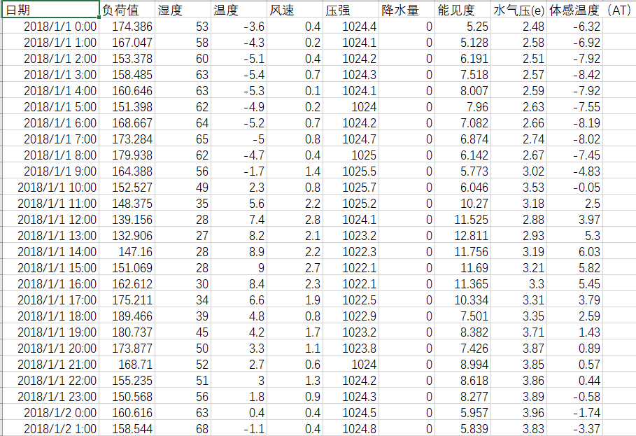
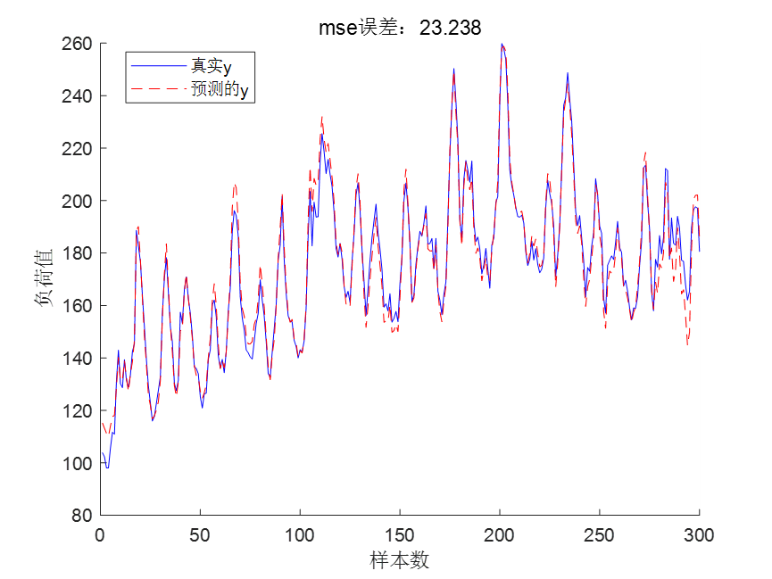
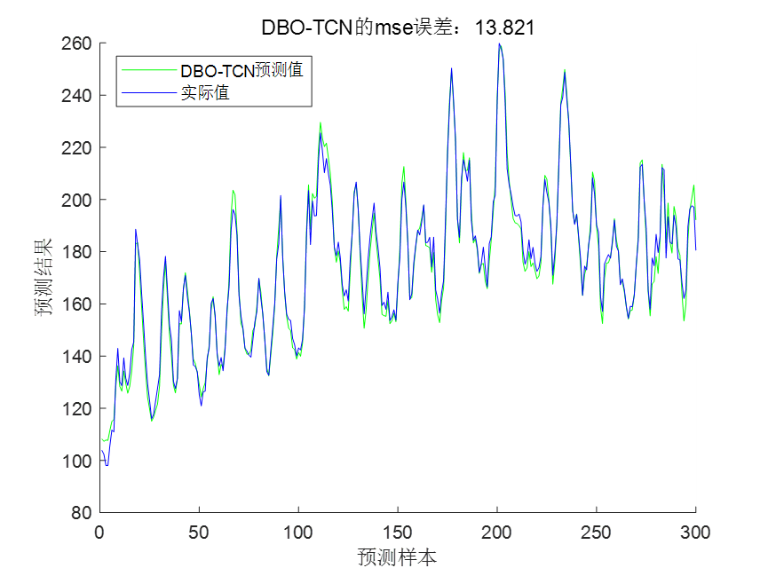
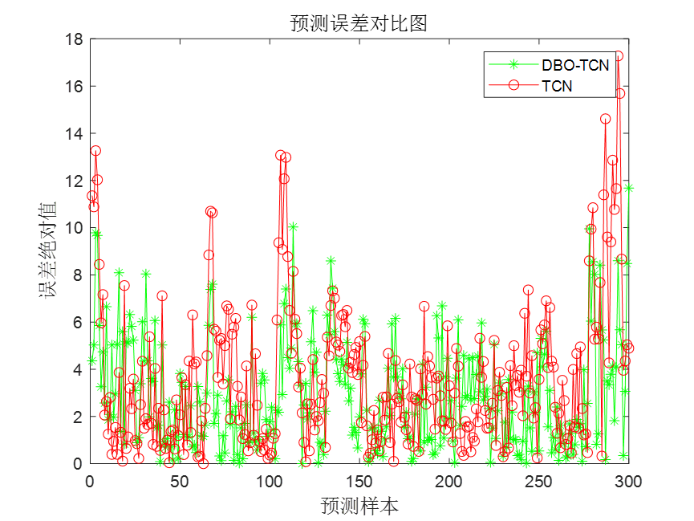
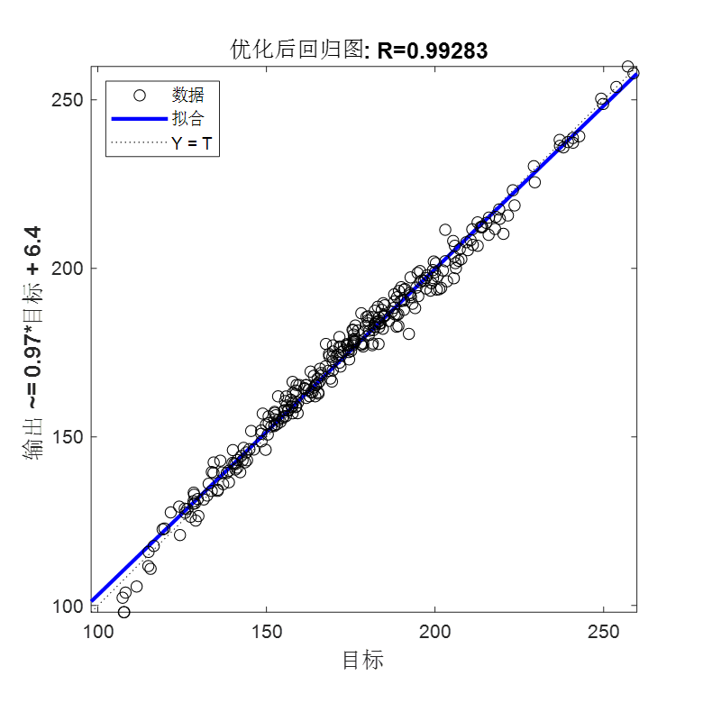
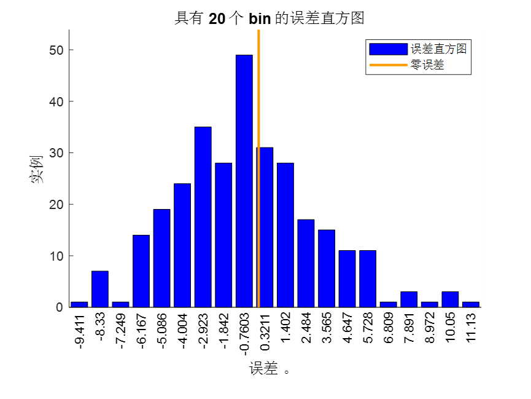
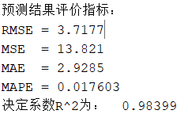
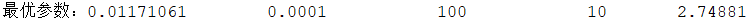

# Optimizing DBO for TCN's power load forecasting, with MATLAB code

Today, we bring you a forecasting session based on DBO-TCN for power load. It must be said that TCN outperforms LSTM in predicting time series data to some extent.
Detailed Explanation of Principles
The article optimizes five parameters of TCN network, which are:
Regularization parameters, learning rate, number of filters, filter size, and block count. These five parameters are among the most important in the TCN network, and their selection can affect the final accuracy.
Optimize TCN with Dung Beetle, parameter settings ranges are:
Regularization parameters [0.001, 0.1] Learning rate [0.0001, 0.01] Number of filters [20, 100] Filter size [2, 10] Blocks [2, 10]
Set the DBO population size to 30 and the number of iterations to 30.
Data Preparation
Processing of power load data
The data set includes load values, temperature, humidity, wind speed, pressure, precipitation, visibility, vapor pressure, and perceived temperature. Some screenshots of the data are as follows:
1200 samples are selected as the training set, each sample composed of all data from that day's 24 hours. Therefore, the input size of the training set is 1200*216, where 216=24*9, 24 represents 24 hours and 9 denotes 9 features. The output size of the training set is: 1200*1, where 1 represents the load value for the next hour.
Select 300 samples as the test set, similarly, the input data size of the test set is 200*216, and the output data size of the training set is: 300*1.
Results display
Training and prediction of power load data using TCN network.
The prediction results of TCN are as follows:
It can be observed that the prediction effect of the unoptimized TCN network is not very ideal, but compared to the prediction effect of the LSTM given in the previous session, it has improved significantly.
The prediction effect of DBO-TCN model is as follows:
The error comparison chart is as follows:
The DBO-TCN prediction results have significantly improved, with the MSE error of DBO-TCN being 13.821, which is a significant improvement compared to the unoptimized TCN's 23.238!
DBN-TCN regression fitting graph:
Error histogram:
Partial code
% Network training\nnet0 = trainNetwork(inputn,outputn,lgraph,options0 );\nan0 = net0.predict(inputn_test);\ntest_simu0=mapminmax('reverse',an0,outputps); %Restore the simulated data to its original magnitude\n% Error Metrics\nerror0 = output_test - test_simu0;\nmse0=mse(output_test,test_simu0)\n%% Standard TCN Neural Network Plotting\nfigure\nplot(output_test,'b-','markerfacecolor',[0.5,0.5,0.9],'MarkerSize',6)\nhold on\nplot(test_simu0,'r--','MarkerSize',6)\ntitle(['TCNOutput the English term only:mseError: ',num2str(mse0)])\nlegend('Truey','Predictedy')\nxlabel('Sample count')\nylabel('Load value')\nbox off\nset(gcf,'color','w')\n\n%% Call DBO to optimize TCN\ndisp('InvocationDBOOptimizationTCN......')\n% DBO optimization parameter settings\nSearchAgents = 20; % Population Size: 30\nMax_iterations = 30; % Iterations: 30\nlowerbound = [0.001 0.0001 20 2 2]; % The lower bounds of five parameters are regularization parameters, learning rate, filter number:numFilters, filter size:filterSize, block number:numBlocks.\nupperbound = [0.1 0.01 100 10 10];    % Maximum limit for five parameters\ndimension = length(lowerbound);% The number, i.e., the number of TCN parameters to be optimized\n[fMin,Best_pos,Convergence_curve,bestnet]  = DBOforTCN(SearchAgents,Max_iterations,lowerbound,upperbound,dimension,inputn,outputn,inputn_test,outputps,output_test,numFeatures,outputSize);\n\nL2Regularization = Best_pos(1,1); % Best L2 regularization coefficient\nInitialLearnRate = Best_pos(1,2) ;% Best initial learning rate\nnumFilters = fix(Best_pos(1,3)); \nfilterSize = fix(Best_pos(1,4));\nnumBlocks = fix(Best_pos(1,5));\ndisp(['Optimal parameters: ',num2str(Best_pos)])\ndisp('Optimization completed, the bestnetExport and use for testing......')\nsetdemorandstream(pi);\n%% Testing the test set\nan = bestnet.predict(inputn_test); \ntest_simu  = mapminmax('reverse',an,outputps);\nerror = test_simu-output_test;\nmsee = mse(output_test,test_simu);\nfigure\nhold on \nplot(test_simu,'g')\nplot(output_test,'b')\nlegend('DBO-TCNPredicted value','Actual value')\nylabel('Prediction results')\nxlabel('Predictive sample')\ntitle(['DBO-TCNOutput the English term only:mseError: ',num2str(msee)])\nbox off\nset(gcf,'color','w')\n\nfigure\nplot(abs(error),'g-*')\nhold on\nplot(abs(error0),'-or')\ntitle('Prediction error comparison chart','fontsize',12)\nxlabel('Predictive sample','fontsize',12)\nylabel('Absolute error','fontsize',12)\nlegend('DBO-TCN','TCN')\n%% Regression plots and error histograms\nfigure;\nplotregression(test_simu,output_test,['Optimized regression plot']);\nset(gcf,'color','w')\n\nfigure;\nploterrhist(test_simu-output_test,['Error histogram']);\nset(gcf,'color','w')\n\n%% Print out evaluation indicators\n% Prediction Result Evaluation\nae= abs(test_simu-output_test);\nrmse = (mean(ae.^2)).^0.5;\nmse = mean(ae.^2);\nmae = mean(ae);\nmape = mean(ae./test_simu);\nR = corr(output_test,test_simu);\nR2 = 1 - norm(output_test -  test_simu)^2 / norm(output_test-mean(output_test ))^2;\ndisp('Prediction results evaluation indicators: ')\ndisp(['RMSE = ', num2str(rmse)])\ndisp(['MSE  = ', num2str(mse)])\ndisp(['MAE  = ', num2str(mae)])\ndisp(['MAPE = ', num2str(mape)])\ndisp(['Correlation coefficientR = ', num2str(R)])\ndisp(['R-squaredR^2To:   ',num2str(R2)])\n  

## Images

<!-- PAYMENT_BLOCK -->

## Get this dataset

- Payment link (Stripe): [Buy now](https://buy.stripe.com/3cs8yP7sY87d0vu9AB)
- Payment QR code: 

<!-- /PAYMENT_BLOCK -->
